<p align="center">
  
</p>

<p align="center">
  <a href="https://cdav.io/"></a>
  <a href="https://x.com/cdav_io"></a>
  <a href="https://www.linkedin.com/in/cristea-david"></a>
  <a href="https://www.youtube.com/@cdav_io"></a>
  <a href="https://www.instagram.com/cdav.io/"></a>
</p>

---

### 🧏 About me

I'm **David**, a **Deaf** trader and developer from **Romania 🇷🇴**.
I build trading tools, macOS apps, developer utilities and games, and I teach trading through **[CDAV.IO](https://cdav.io/)**.

```js
const david = {
  role:       "Trader · Developer · Founder of CDAV.IO",
  mission:    "Building a trading super intelligence",
  based:      "Romania 🇷🇴",
  deaf:       true,
  signs:      ["LSR 🇷🇴", "ISL 🌍", "ASL 🇺🇸"],
  builds:     ["trading tools", "macOS apps", "dev tools", "games", "web apps"],
  mindset:    "ship fast, learn faster",
};
```

### 🎯 What I build

| | |
|---|---|
| 📈 **Trading** | Systems, market structure tools and AI for traders |
| 🍎 **macOS** | Native utilities that keep your Mac clean, fast and organized |
| 🛠️ **Dev tools** | Tools that save hours: terminal, browser, automation |
| 🎮 **Games** | Game dev experiments, from prototypes to playable builds |
| 🌐 **Web** | Fast, accessible sites and apps, built Deaf-first |

### 🚀 Repositories

<p align="center">
  <a href="https://github.com/CDAVIO?tab=repositories"></a>
</p>

### 🧠 I build

<p align="center">
  
</p>
