<p align="center">
  <a href="https://www.instagram.com/cdav.io/"></a>
</p>

<p align="center">
  <a href="https://cdav.io/"></a>
  <a href="https://x.com/cdav_io"></a>
  <a href="https://www.linkedin.com/in/cristea-david"></a>
  <a href="https://www.youtube.com/@cdav_io"></a>
  <a href="https://www.instagram.com/cdav.io/"></a>
</p>

---

### 🧏 About me

I'm **David**, a **Deaf** trader and developer from **Romania 🇷🇴**.
I build trading tools, macOS apps, developer utilities and games, and I teach trading through **[CDAV.IO](https://cdav.io/)**.

```js
const david = {
  role:       "Trader · Developer · Founder of CDAV.IO",
  mission:    "Building a trading super intelligence",
  based:      "Romania 🇷🇴",
  deaf:       true,
  signs:      ["LSR 🇷🇴", "ISL 🌍", "ASL 🇺🇸"],
  builds:     ["trading tools", "macOS apps", "dev tools", "games", "web apps"],
  mindset:    "ship fast, learn faster",
};
```

### 🎯 What I build

| | |
|---|---|
| 📈 **Trading** | Systems, market structure tools and AI for traders |
| 🍎 **macOS** | Native utilities that keep your Mac clean, fast and organized |
| 🛠️ **Dev tools** | Tools that save hours: terminal, browser, automation |
| 🎮 **Games** | Game dev experiments, from prototypes to playable builds |
| 🌐 **Web** | Fast, accessible sites and apps, built Deaf-first |

### 🤖 AI-first builder

I use AI every day to **save time** and ship faster, from code to content.

| | What I make with AI |
|---|---|
| 💻 **Code & apps** | macOS tools, websites, trading tools and games |
| 📄 **Documents** | Courses, guides, trading plans and reports |
| 🖼️ **Images** | Thumbnails, social posts, brand visuals |
| 🎬 **Video** | Lessons, shorts and edits for YouTube and Instagram |
| 🎵 **Audio & music** | Music, sound and voice for videos |

**Tools I use**
<br />


### 🚀 Repositories

| Project | What it does | Stack |
|---|---|---|
| 📸 **[Sort](https://github.com/CDAVIO/Sort)** | Free photo organizer for macOS and Windows. Sorts your camera roll into folders by device, date and place, offline, with no account. |   |
| 🧹 **[MacUp Cleaner](https://github.com/CDAVIO/MacUp-Cleaner-CDAV.IO)** | Open-source Mac health tool for the Terminal: clears hidden "System Data" caches, checks battery, SSD, RAM, CPU, GPU and security, exports a PDF report. |   |
| 🔤 **[Diacritics Remover](https://github.com/CDAVIO/Diacritics-remover)** | Paste text with ș ț ă â î, Polish, Nordic or German letters and get clean plain text, copied automatically. Runs in your browser. |  |
| 🌐 **[CDAV.IO](https://github.com/CDAVIO/CDAV.IO)** | Landing page for CDAV.IO: trading education in International Sign Language. |  |

### 📈 GitHub streak

<p align="center">
  
</p>

<p align="center"><sub>Education only. Not financial advice.</sub></p>
